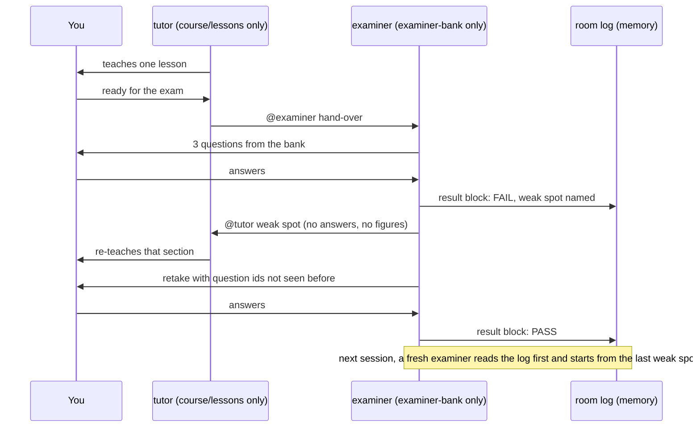

# Exam Room

A Switch workflow for self-study: one room where a tutor agent teaches a short lesson and a **separate** examiner agent sets and marks an exam on it. The room's own message log is the memory: a later examiner session starts from the weak spots an earlier one found (seen once, `docs/evidence/rehearsal-memory-2026-11-06.md`).

Built for the Flip the Switch hackathon (November 4-7, 2026), Track 2.

**Demo video:** _link to be added before submission_

## Why this exists

Ask one AI agent to teach you something and then test you, and it marks its own teaching. It explained the idea, it wants you to have understood, and it holds the answers while it asks the questions. That is the failure we wanted to remove: a quiz that is easy to pass, with a hint of the answer free to slip into a question. Close the chat, and whatever it learned about your mistakes is gone too.

A typical case: a team lead wants a new hire to understand unit economics before they touch pricing. One agent teaches the lesson, asks "makes sense?", and accepts a half-right answer. Next week nobody knows which part the new hire got wrong.

Exam Room splits teaching from marking. The tutor and the examiner are two agents with separate folders. The examiner is told never to reveal an answer, and the tutor was refused when it tried to open the question bank. The room's message log is the only memory, so a new session starts from the last weak spot instead of from zero.

**Who it is for:** teams onboarding or training people, anyone who needs to check knowledge rather than just deliver it, and course creators who want a marker that is not the teacher.

## Why Switch

The split is held by Switch and by per-agent settings, not by prompts alone. Room membership and addressing decide who reads the room and who can direct each agent. The tutor works in `course/lessons` and the examiner in `examiner-bank`, and the settings file stops each agent's file reads at its own folder and removes the shell and web tools, so the tutor's read of the bank was refused in the rehearsal. What the agents say is still convention: only the examiner marks, a result block reveals no answer, and the examiner reads the room log before its first question. The table under [What is enforced and what is convention](#what-is-enforced-and-what-is-convention) marks each rule.



In the rehearsals behind this diagram, the person's answers were sent from the owner's Console chats, not typed in the room by a separate student (`docs/evidence/rehearsal-exam-2026-11-06.md`, `docs/evidence/rehearsal-memory-2026-11-06.md`).

| | One agent teaches and tests | Exam Room on Switch |
|---|---|---|
| Who marks you | The agent that just taught you, with the answers in view | A separate examiner in its own folder |
| Can the teacher see the answers | Yes, same context | The tutor's read of the bank was refused |
| Answers leaking into feedback | Nothing separates them | Result blocks name a weak spot, never an answer (convention; held in one rehearsal, 17 posts searched) |
| Memory between sessions | Gone with the chat | The room log. A fresh examiner session cited the earlier result block by its message id |
| Disagreeing with a mark | Argue with the agent | An `OVERRULE:` line written into the room |

**Read this first.** The setup below has been tested in parts, on the author's own Switch Console. One full exam has been rehearsed from start to finish: a fail, a re-teach, a pass on the retake and an overrule (`docs/evidence/rehearsal-exam-2026-11-06.md`). In that rehearsal the person's answers were sent from Console chats, not typed in the room, and it is not the recorded run. This README says "is meant to" for anything that has not been seen running, and the section [Not yet observed](#not-yet-observed) lists those things in one place.

## What it is

Studying alone has a known weakness: you mark your own work. Asking one AI agent to teach you and then test you has the same weakness in a new form, because the agent that explained the idea is the one deciding whether you understood it, and it holds the answers while it teaches.

Exam Room splits the two jobs:

- The **tutor** teaches one lesson at a time and answers questions. It never marks, and the setup is meant to leave it no way to open the question bank. The table further down says what backs that.
- The **examiner** asks three questions from a bank only it works in, marks each answer, and posts a fixed result block: topic, question ids, score, weak spot, PASS or FAIL.
- **You** answer the questions. You can overrule a mark, and the overrule is written into the room.

On a FAIL, the examiner names the weak spot to the tutor, the tutor re-teaches that spot, and you retake with questions you have not seen. The full rules are in [`material/exam-rules.md`](material/exam-rules.md), and the same text is loaded into the room as a room document.

The sample course is three short lessons on unit economics for a made-up coffee subscription business. Every business and figure in `course/` and `examiner-bank/` is fictional and illustrative.

## How Switch is used

Everything happens in one Switch room, created from [`templates/exam-room.template.yaml`](templates/exam-room.template.yaml). With `study` as the team prefix:

| Piece | Name | What Switch does with it |
|---|---|---|
| Room | `study-exam-room` | Holds both agents and you. Mirrored to your messaging app through a bridge. The template asks for a private channel |
| Agent | `study-tutor` | Runs in `course/lessons`. Teaches, hands over to the examiner, re-teaches after a FAIL |
| Agent | `study-examiner` | Runs in `examiner-bank`. Asks, marks, posts result blocks |
| Addressing | `anyone` on both agents | You direct either agent by mentioning it, and the agents hand over to each other the same way: the tutor mentions `@study-examiner` to start an exam, the examiner mentions `@study-tutor` with the weak spot after a FAIL |
| Room document | `Exam rules` | The result block format and the rules, given to every agent in the room |
| Room log | the room's messages | The memory. Result blocks and overrules stay in the room, and the examiner is told to read them before its first question in a session |

```
                 you, in your messaging app
                            |
                         (bridge)
                            |
   +------------------------+-------------------------+
   |  study-exam-room                 one Switch room |
   |                                                  |
   |  room document:  Exam rules                      |
   |  room log:       lessons, answers, result blocks,|
   |                  overrules  = the memory         |
   +-----------+--------------------------+-----------+
               |                          |
        study-tutor                 study-examiner
        works in course/lessons     works in examiner-bank
        teaches, re-teaches         asks, marks, posts
        meant to be refused         the result block
        the bank
               |                          |
               +---- @mention to start ---+
               +---- @mention on FAIL ----+
```

### What stops working without Switch

- **The separation.** Tutor and examiner are two agents with two working folders, joined only by the room. In a single agent session there is one context, and whatever marks you has also been teaching you with the answers in view.
- **The handover.** The tutor starts an exam and the examiner returns a weak spot by addressing each other by name in the room. Without a shared room and addressing there is nothing to carry that message between two separate agents.
- **The memory.** Neither agent is asked to keep notes. What was failed, and what was overruled, is in the room's log, outside both agents. Without the room, a new session starts with nothing.
- **You in the loop.** You answer and overrule from your messaging app, in the same place the agents post. Without the bridge there is no shared place for the three of you.

## Set it up

You need Switch Console, Claude Code, a messaging app that Switch can bridge to, and Node if you want to run the checks. The versions this was tried with are in [`docs/switch-notes.md`](docs/switch-notes.md).

**1. Clone the repo** and note the absolute path of the clone. The wizard needs absolute paths.

**2. Make a dedicated Claude Code config folder.** The agents must run under [`docs/claude-settings.example.json`](docs/claude-settings.example.json). It removes the shell and web tools and stops file reads outside an agent's working directory. Keep it out of your everyday Claude Code config: you do not want those limits on your own sessions, and you do not want your own allow rules and tools reaching these agents.

```
mkdir ~/exam-room-claude-config
cp docs/claude-settings.example.json ~/exam-room-claude-config/settings.json
export CLAUDE_CONFIG_DIR=~/exam-room-claude-config
```

A new config folder starts logged out, so log in to Claude Code once with that variable set.

**3. Start Switch Console** so that the agents it starts get `CLAUDE_CONFIG_DIR`. Starting it from the terminal where you exported the variable is the intended way. An app opened from a launcher does not usually inherit a terminal's variables.

**4. Connect a messaging app** in Console. With none connected, Create all stays disabled.

**5. Import the template.** Templates > Import template > choose `templates/exam-room.template.yaml` > Save > Use template. Saving does not check the template. The wizard does.

**6. Fill in the wizard inputs**, then Create all.

| Input | What to enter |
|---|---|
| `team` | A short lowercase prefix, for example `study`. It becomes `study-tutor`, `study-examiner` and `study-exam-room` |
| `lessons_dir` | The absolute path of `course/lessons` in your clone |
| `bank_dir` | The absolute path of `examiner-bank` in your clone |
| `bridge` | The messaging app to mirror the room to. Defaults to the first one connected |
| `location` (advanced) | Leave as `local` |

**7. Check the limits before you rely on them.** In the room, ask the tutor to read a file in the examiner's folder by its full path, and ask it to run any shell command. It is meant to be refused both times, and the file refusal should name `permissions.blockReadsOutsideWorkingDirectories`. If the tutor can do either, the settings file is not in use: stop, archive the room and agents, and go back to step 2.

**8. Use it.** Type in the room from your messaging app. Console shows a mirrored room but has no box to type in. The room opens with the tutor listing the three lessons. Pick one, ask questions, and say when you are ready. The tutor then calls the examiner.

To run the checks:

```
node --test "templates/*.test.mjs"
```

These are text checks on the template and the settings files. They do not start Switch or an agent.

## What is enforced and what is convention

"Enforced" means something other than an agent's good behaviour holds the rule. "Convention" means the rule is written in an agent's instructions or the room document, and the agent is trusted to follow it.

| Rule | What holds it | Kind | Source |
|---|---|---|---|
| An agent that is not in a room cannot read it or post in it | Switch room membership | Enforced | observed, see docs/switch-notes.md |
| Who may direct an agent follows its `addressing` setting | Switch | Enforced | observed, see docs/switch-notes.md |
| A Claude agent has no shell tool and no web tool | The user-level settings file | Enforced, only with that file in use | observed, see docs/switch-notes.md |
| A Claude agent's file tools refuse any path outside its working directory | The user-level settings file | Enforced, only with that file in use | observed, see docs/switch-notes.md |
| An agent whose folder denies Edit and Write has no file-editing tools | `.claude/settings.json` in the agent's folder | Enforced | observed, see docs/switch-notes.md |
| This repo's tutor is refused when it tries to open the examiner bank | The two rows on file tools, applied here: the tutor works in `course/lessons`, the bank is in `examiner-bank` | Enforced | observed in the rehearsal: the tutor's read of the bank file by its full path was refused |
| This repo's tutor and examiner cannot change the lessons or the bank | `course/lessons/.claude/settings.json` and `examiner-bank/.claude/settings.json` | Enforced | observed in the rehearsal: both agents reported no shell tool and no file-writing tool, and no file was created |
| The room's channel is closed to other people in the messaging app | `channel_type: channel_private` in the template | Unknown | not yet observed |
| Only the examiner marks, and the tutor never calls a topic passed | Agent instructions and the room document | Convention | held in the rehearsal, one exam |
| Only a person's answer counts | Agent instructions and the room document | Convention | the examiner said so in the rehearsal. An answer passed on by an agent was not tried |
| A result block reveals no answer, worked figure or marking note | Agent instructions and the room document | Convention | held in the rehearsal: three blocks and 17 examiner posts searched |
| The examiner starts a session from the weak spots already in the room log | Agent instructions and the room document | Convention | held in `docs/evidence/rehearsal-memory-2026-11-06.md`: a fresh examiner session cited the earlier result block by its message id |

The rows that point to `docs/switch-notes.md` were seen on agents started by Console in a sibling workflow by the same author, under the same settings file. The rows that say "rehearsal" were seen on this repo's own tutor and examiner, once, in `docs/evidence/rehearsal-exam-2026-11-06.md`.

Two more things, neither of them an agent rule:

- The template never sets `auto_approve`, so no agent is told to skip permission prompts. The checks pin this.
- Nothing stops **you** from opening the bank. It is in a public repo. This is an honesty exam.

## Not yet observed

None of the following has been seen running. Each is what the workflow is meant to do, and each stays in this list until there is a recording or a saved room log in `docs/evidence/`.

- A person typing their answers in the room from the messaging app. The one rehearsal sent them from Console chats.
- The tutor starting fresh. Killing its process made Console resume the same session, so only the examiner has been seen starting from the room log with no private memory.
- An answer passed on by an agent being refused.
- Whether `channel_private` closes the channel in the messaging app.
- A second person in the room.

## Safety notes

- **Do not admit strangers.** Both agents use `addressing: anyone`, which is meant to let any member of the room direct them. The template puts one person in the room: whoever creates it. Keep it that way, and check the channel's permissions in your messaging app yourself, because the private channel setting is untested.
- **Agents run as your user.** Console starts each agent as a process under your own account on your own computer. What limits an agent here is a set of tool rules in Claude Code's settings. It is not a separate account, a container or an operating-system wall.
- **Why no shell.** A shell gives an agent everything your account can do. Before the settings file was added, an agent in a test room was able to read a file in the home folder and reach the internet with shell commands. Claude Code's own operating-system sandbox setting stalled agents started by Console, so it is not used. What is left is to remove the shell altogether, remove the web tools, and stop each agent's file tools at its own folder. Teaching and marking need none of those.
- **The settings file is the whole boundary.** If Console starts agents without it, the tutor can open the bank and both agents have a shell. Step 7 above is how you find out.
- **One provider for now.** Both agents run on Claude Code because, in the author's tests, a Codex agent started by Console could read the whole home folder and use a web tool, and Console did not apply a tighter permission profile.
- **Switch's own tools.** Agents also see Switch's tools for rooms and agents, including ones that create agents and rooms and add people. Which of these an `anyone` agent can really use has not been tested.
- **The room log is readable by everyone in the room.** Do not paste secrets into it.

## Tested on the author's Console, not a fresh machine

Everything marked observed was seen on one computer, on Switch Console 0.40.1 with Claude Code 2.1.311 and a Discord bridge. Nobody has yet cloned this repo onto a clean machine and followed the steps above from the top. If a step fails for you, the likely places are step 3 (whether Console passes the config folder on to its agents) and the wizard's handling of directory inputs.

## What is in the repo

| Path | What it is |
|---|---|
| `templates/exam-room.template.yaml` | The Switch template: two agents, one room, the room document |
| `templates/template.test.mjs` | Text checks on the template and settings files |
| `material/exam-rules.md` | The exam rules. The room document is this file, word for word |
| `course/lessons/` | Three sample lessons. The tutor's working folder |
| `examiner-bank/` | Questions and marking notes for each lesson. The examiner's working folder |
| `docs/claude-settings.example.json` | The user-level Claude Code settings the agents must run under |
| `docs/switch-notes.md` | What was seen running, with dates |
| `docs/video-plan.md` | The shot list for the demo video |
| `docs/evidence/` | A saved copy of the hackathon rules, and the logs of the two rehearsals so far |

## Licence

MIT. See [`LICENSE`](LICENSE).
